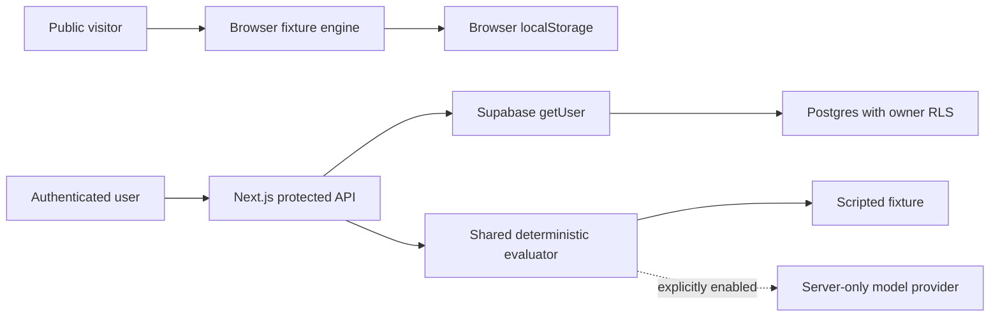

# TraceEval architecture

TraceEval makes structured AI output inspectable: fixed-schema validation and exact citation checks are kept separate from human factual-support judgments. Synthetic targets demonstrate software behavior; they are not model benchmark observations.

## Two execution paths

The default public demo runs the same evaluator in the browser, loaded on demand. It makes no evaluation, review, or database API request. Visitors cannot trigger paid inference or anonymous database writes. Static evidence/dataset assets remain publicly inspectable. Demo run history is limited to eight runs; users can export and delete runs.

When Supabase is configured, the browser restores the Auth session and can switch between the demo and an account workspace. The two histories are separate. Private results never enter demo localStorage. Account changes/sign-out clear account state, abort pending reads, and prevent stale operation responses from entering another workspace. Auth tokens are stored by the standard Supabase browser client; protect against XSS and provision only trusted accounts. No HttpOnly-cookie authentication claim is made.

## API surface

| Route | Behavior | Authorization |
| --- | --- | --- |
| `POST /api/evaluate` | Validate 1–500 unique case IDs, evaluate, save run | Supabase token verified by `getUser` |
| `GET /api/runs` | Load up to 50 owned runs and their reviews | Verified Supabase token + RLS |
| `DELETE /api/runs?id=...` | Delete owned run and cascading reviews | Verified Supabase token + RLS |
| `POST /api/reviews` | Save 0–2 human score and mandatory rationale | Verified token, case membership, RLS |

Request bodies are limited to 16 KiB. Inputs are Zod-validated. User-supplied ownership fields are rejected; the server derives ownership from the verified identity. Private responses and error responses use `Cache-Control: no-store`. Errors do not expose provider bodies or credentials.

## Evaluation and provenance

`lib/dataset.ts` generates 500 seeded targets and 300 fictional documents. `data/manifest.json` records the canonical SHA-256; generation checks verify byte consistency. `lib/runner.ts` can run in Node or the browser. The model adapter stays in `lib/live.server.ts`, imported only by server code.

The fixed JSON Schema is validated by AJV without coercion. Citations must refer to assigned evidence and match exact UTF-16 spans. Coverage checks declared claims only. Exact target answer/abstention matching is a synthetic diagnostic. Human judgments remain separately labeled with a rationale; no model grader is available. Runs retain raw output, selected cases, model/adapter, dataset hash, evaluator version, times, and per-case errors.

## Database

The original migration creates owner-scoped runs/reviews, composite foreign-key isolation, and an atomic live quota function. The forward production migration adds run payload shape/size constraints, a 50-run owner limit, and database-enforced review case membership. Advisory locks serialize quota/limit reservations. Application users use a public Supabase key and their own JWT; no service-role key is used at runtime.

Live inference is off by default. Enabling it requires authenticated storage, a server-only key, a compatible model, and an allowed HTTPS provider hostname. Endpoint URLs cannot come from requests. Redirects, IP/local hosts, URL credentials, custom ports, and query strings are rejected. Each case has a 4-second timeout and bounded response size. Quotas are 10 cases/minute and 100 cases/rolling day per user; failures do not refund reservations. Deployment administrators must maintain the hostname allowlist and provider spending limits. This is not a penetration-test or security-certification claim.

## Deployment and current boundary

GitHub hosts source and runs fixture/browser/Postgres CI. Vercel hosts Next.js. Production uses the public demo until a dedicated Supabase project can be provisioned. The TraceEval Supabase organization exists, but project creation was rejected because the account already owns two active free projects. The user explicitly chose to leave this blocked rather than pause another project or enable billing. Hosted authentication/persistence therefore remain unavailable and unverified.

Actual release identifiers and verification receipts are recorded in `docs/PRODUCTION_VERIFICATION.md` and `artifacts/verification.json`.
